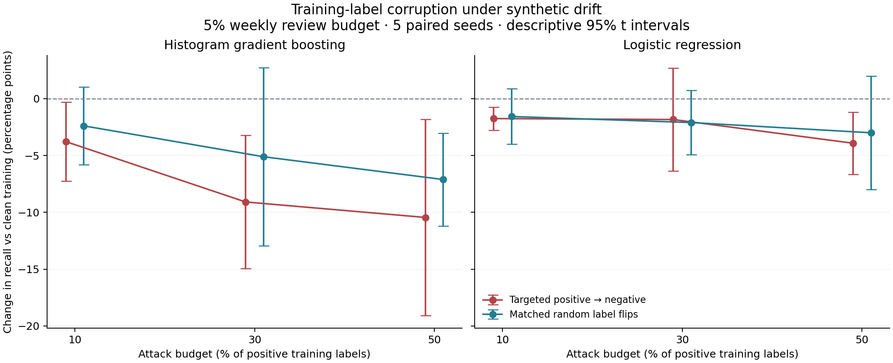
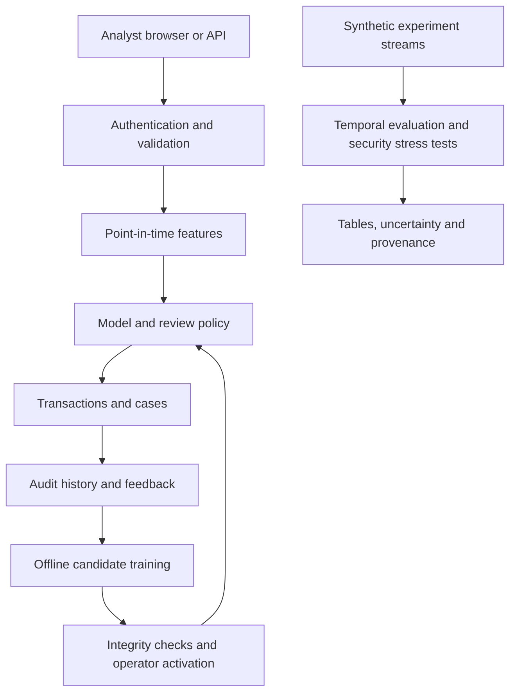

# UPI Guard

### ML security and fraud-risk research sandbox

How do temporal drift, delayed labels, limited review capacity and corrupted feedback affect fraud-risk models?
UPI Guard combines reproducible experiments with an authenticated investigation application to study that question.

**Synthetic data only.** This project cannot send money, authorize a UPI payment or block one. Its results describe authored simulators, not real banking performance.

[Quick start](docs/QUICKSTART.md) · [Research results](docs/RESEARCH_RESULTS.md) · [ML security experiment](docs/ML_SECURITY_RESULTS.md) · [Threat model](docs/THREAT_MODEL.md) · [Validation](reports/VALIDATION_V22.md)

## What this project demonstrates

- **Reliable ML evaluation:** chronological train/calibration/validation/test partitions, three classical learners, capacity-aware thresholds, cold-start analysis and point-in-time features.
- **Controlled research:** paired stationary/drift streams, delayed-label retraining, graph/novelty ablations and uncertainty over independent seeds.
- **ML security:** a bounded label-poisoning experiment with equal-count random corruption controls; explicit attacker capabilities, immutable test truth and reproducible results.
- **Security engineering:** role enforcement, CSRF, rate limits, idempotent scoring, optimistic case updates, audit history and model-integrity checks before deserialization.
- **Reproducible delivery:** pinned runtime, editable Python install, CLI, tests, CI, Docker configuration, data/model cards and release checksums.

The contribution is the evaluation and engineering of a complete research workflow. No new learning algorithm or validated poisoning defense is claimed.

## Selected evidence

| Study | Design | Finding and limit |
|---|---|---|
| Application model | 12,000 synthetic events; 2,400-event chronological test | AP **0.633**, ROC-AUC **0.951**, but **11.8% recall at 1.79% alerts**. Ranking quality alone does not establish an effective operational policy. |
| Original drift study | 5 seeds, 2 learners, paired arms, 7 strategies | Fixed HGB recall falls from **71.5% to 24.5%** in the drift arm; the paired stationary control supports deterioration beyond ordinary stream variation. |
| New label-corruption study | 5 different seeds, 2 learners, paired arms, 7 treatments; **140 fits** | In the drift arm, HGB recall falls from **31.1% to 20.7%** when half of positive training labels are flipped. Paired change: **−10.4 pp**, descriptive 95% CI **[−19.1, −1.8]**. |

The two research studies use different seeds and protocols; their absolute scores are not directly interchangeable. The poisoning experiment changes **50% of positive labels**, not 50% of all labels. Its targeted-versus-random contrast under drift is inconclusive. Full tables and limitations are in the linked reports.



## Run locally

Use **Python 3.12** from the project root. Installation and CLI use a source checkout; standalone wheel deployment is not supported.

```bash
python3.12 -m venv .venv
source .venv/bin/activate
python -m pip install -r requirements.lock
python -m pip install --no-deps -e .
python -m upi_guard init
python -m upi_guard demo --count 300
python -m upi_guard serve
```

Open **http://127.0.0.1:5000**. `init` prompts for an administrator password; there is no bundled login.
For Windows PowerShell commands, Docker setup and troubleshooting, see [Quick start](docs/QUICKSTART.md).
The included joblib model is a trusted local demo artifact; never replace it with an untrusted download.

## Reproduce and validate

```bash
python -m pip install -r requirements-dev.txt
python -m pytest -q
python -m unittest discover -s research/tests -v
python -m research.verify_results research/results
python -m experiments.poisoning --verify
python scripts/release_check.py
```

To rerun the security study into a new, ignored output directory:

```bash
python -m experiments.poisoning --out experiments/results/local-reproduction --seeds 5 --seed-start 100 --episodes 240
python -m experiments.poisoning --out experiments/results/local-reproduction --verify
```

The original study's rerun instructions are in [research/README.md](research/README.md).
The application model and historical experiment sources remain separate from new experiments.
Fresh training produces a candidate; activation is an explicit operator action.

## Architecture



The database preserves the features available when a transaction was scored. Late arrivals do not rewrite old assessments. Research scripts use the same feature definitions, with separate datasets and model fits.

## Navigate the repository

| Location | Purpose |
|---|---|
| `upi_guard/` | Flask application, schema, features, scoring, feedback, monitoring and model lifecycle |
| `tests/` | Application, concurrency, security-boundary and experiment regression tests |
| `research/` | Original controlled drift/delay/ablation study and preserved results |
| `experiments/` | Training-label corruption experiment, accounting, paired estimates and figure |
| `data/`, `artifacts/` | Synthetic demo data and versioned application model |
| `docs/` | Research explanation, model/data cards, threat model, setup and portfolio guidance |
| `reports/` | Actual validation evidence; older reports retain their original scope |
| `.github/` | CI, dependency updates and review template |

## Read next

- [Project report](docs/PROJECT_REPORT.md): question, design, contribution and limitations.
- [Model card](docs/MODEL_CARD.md) and [data card](docs/DATA_CARD.md): intended use, metrics and provenance.
- [Threat model](docs/THREAT_MODEL.md): assets, attacker capabilities, tests and residual risks.
- [Revision review](docs/REVIEW_V22.md): concrete findings and changes made in this revision.
- [Portfolio guide](docs/PORTFOLIO.md): defensible resume bullets, demonstration and interview preparation.
- [Roadmap](docs/ROADMAP.md): the next experiments that would materially strengthen this work.
- [GitHub publishing](docs/PUBLISHING.md): first commit, repository settings and attribution/license checks.

## Scope

This is a single-organization research workspace, not a production payment system. It has no live UPI integration, independently audited security, validated anti-poisoning defense, or real-world fraud-effectiveness evidence. Cold-start failures, simulator shortcuts, selection bias, unsigned artifacts and mutable database audit history remain explicit limitations. See [security boundaries](docs/SECURITY.md).
