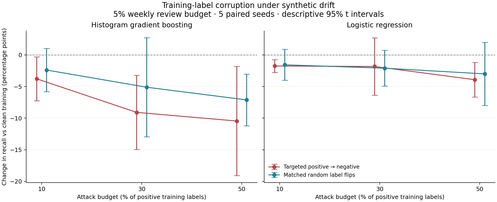

# ML security experiment: bounded training-label corruption

This is a synthetic stress test of initial training-label integrity. It does not measure a live UPI attack or demonstrate a new defense.

## Protocol

Completed 140 fits and 1680 weekly evaluations across 172,800 unique simulated events, seeds 100–104, two learners and matched stationary/drift arms.
Training uses weeks 5–8; evaluation uses weeks 12–23. Evaluation labels are latent simulator truth and are never corrupted. Models and the 5% weekly ranking budget are fixed before scoring. This experiment assumes zero additional label delay; delay is studied separately in the original suite.

The attacker relabels 10%, 30% or 50% of observed positive training labels as legitimate. A matched random control flips exactly the same number of labels, sampled across all training rows. Both controls share the same features, temporal splits, model seeds and eventual evaluation labels. Equal counts do not equalize class prevalence, which is one mechanism being measured.

## Recall in weeks 18–23

Percent; brackets are descriptive 95% t intervals over seed-level weekly means. Intervals are not bounds on real-world performance.

| Arm | Learner | Clean | Targeted, 50% | Random, matched count |
|---|---|---:|---:|---:|
| control | HGB | 69.1 [64.0, 74.3] | 63.5 [59.7, 67.4] | 67.9 [63.9, 72.0] |
| control | LR | 70.4 [64.2, 76.6] | 66.2 [59.4, 73.1] | 70.4 [65.0, 75.9] |
| drift | HGB | 31.1 [21.3, 40.9] | 20.7 [13.9, 27.4] | 24.0 [14.4, 33.6] |
| drift | LR | 16.5 [10.3, 22.7] | 12.6 [7.3, 18.0] | 13.5 [10.7, 16.4] |

## Paired differences

Recall difference in percentage points; negative means the first condition catches fewer positive events.

| Arm | Learner | Targeted minus clean | Targeted minus random |
|---|---|---:|---:|
| control | HGB | -5.6 [-8.4, -2.8] | -4.4 [-8.1, -0.7] |
| control | LR | -4.1 [-6.8, -1.4] | -4.2 [-6.9, -1.5] |
| drift | HGB | -10.4 [-19.1, -1.8] | -3.3 [-11.4, 4.8] |
| drift | LR | -3.9 [-6.7, -1.2] | -0.9 [-6.0, 4.2] |

The largest attack changes 1.88%–2.26% of **all** initial training labels. The 50% figure refers to positive labels only.

## Interpretation

At the largest tested budget, targeted corruption lowers mean recall relative to clean training in both arms and learners; the displayed paired intervals exclude zero. In the drift arm, targeted-versus-random intervals cross zero for both learners. This run therefore does not establish that targeting is consistently more harmful than equally sized random corruption under drift. Intermediate budgets and AP/Brier results are available in the complete tables; no outcome was used to select a model or attack budget.

This supports treating label provenance and adjudication as model-security concerns. It does not validate the application's workflow as a poisoning defense: corrupted but schema-valid labels remain possible, and privileged administrators are inside the trust boundary.

## Limits

Five authored-simulator seeds, exploratory comparisons without multiplicity correction, and no independent external dataset limit generalization. The attacker has direct access to selected initial training labels; this is not an experiment on only the cases reachable by one analyst. There is no optimized evasion, feature poisoning, backdoor, online attack, selective review simulation, or adaptive retraining defense. Ranking sees an entire week and is not a real-time capacity guarantee. Fixed-seed replication tests reproducibility; an external confirmation set is still needed.

## Reproduce

```bash
python -m experiments.poisoning --out experiments/results/local-reproduction --seed-start 100 --seeds 5 --episodes 240
python -m experiments.poisoning --out experiments/results/local-reproduction --verify
python -m experiments.report --input experiments/results/poisoning --output docs/ML_SECURITY_RESULTS.md
```

The runner refuses to overwrite a directory. `protocol.json` records versions, source hashes and all treatments; `completion.json` records output hashes. These detect mismatches, not authenticity against a writer who can replace both files and manifests.


