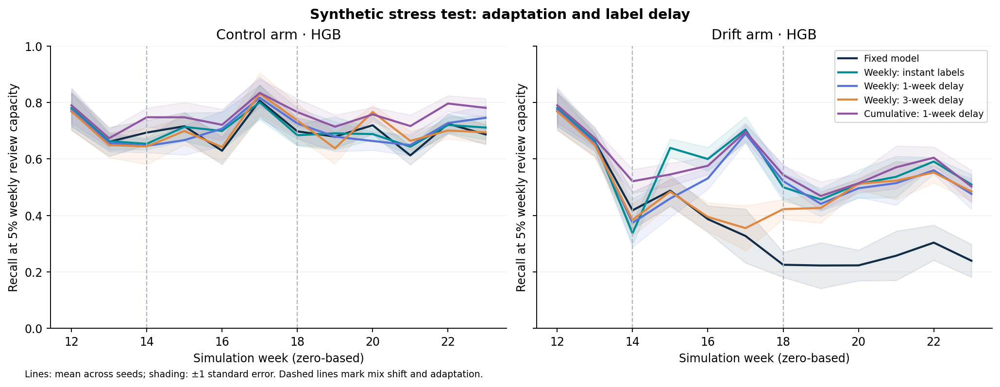
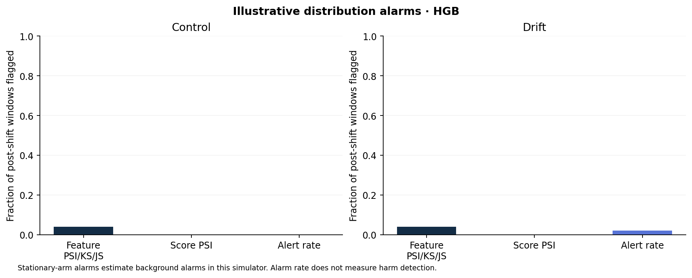

# Verified research results

Historical study retained from the uploaded project. The validation scope below describes that earlier study; current application checks and the new security experiment are recorded in [VALIDATION_V22.md](../reports/VALIDATION_V22.md) and [ML_SECURITY_RESULTS.md](ML_SECURITY_RESULTS.md).

This is a fresh synthetic study built from the uploaded reviewed application. The earlier conversational experiment package was absent, so its reported eight-seed results are not reused. The research question and full limitations are in [RESEARCH_PLAN.md](RESEARCH_PLAN.md).

**Completed:** 5 seeds (0–4), HGB and logistic regression, matched drift/stationary arms, seven strategies, 24 simulated weeks per arm. There are 172,800 generated events across seed/arm runs, 1,680 weekly strategy rows and 240 monitoring rows. Each arm has 17,280 events; the two models reuse those events. A source-hash and completeness check passed.

## Fixed-model change and the stationary control

Recall at a 5% weekly ranking budget, in percent. Brackets are descriptive 95% t intervals across five seed means. The adapted phase is weeks 18–23; pre-shift is weeks 12–13.

| Learner | Drift pre-shift | Drift adapted | Stationary adapted | Paired difference in differences (pp) |
|---|---:|---:|---:|---:|
| HGB | 71.5 [56.2, 86.7] | 24.5 [8.4, 40.7] | 68.7 [63.9, 73.4] | -44.1 [-60.8, -27.5] |
| LR | 75.4 [63.3, 87.5] | 17.0 [7.1, 26.9] | 68.0 [63.2, 72.7] | -51.0 [-61.8, -40.2] |

The paired contrast is `(adapted - pre)_drift - (adapted - pre)_stationary`. Its negative intervals support additional deterioration caused by the scheduled intervention in this simulator. The stationary stream also varies; a raw before/after decline alone would overstate attribution. Because both the intervention and its measurable signals were designed here, decay itself is not a novel discovery.

## Retraining and label delay

Adapted-phase recall in the drift arm, percent [95% t interval]. All weekly fits use only outcomes that have arrived before that week.

| Strategy | HGB | Logistic regression |
|---|---:|---:|
| static | 24.5 [8.4, 40.7] | 17.0 [7.1, 26.9] |
| weekly_delay0 | 51.7 [47.2, 56.2] | 36.2 [33.9, 38.6] |
| weekly_delay1 | 50.1 [44.9, 55.3] | 35.3 [31.9, 38.7] |
| weekly_delay3 | 48.7 [43.4, 53.9] | 31.0 [26.0, 36.0] |
| cumulative_delay1 | 53.4 [49.7, 57.0] | 29.3 [23.6, 35.0] |

Both learners benefit from retraining compared with the fixed model in the adapted phase; paired differences are in `paired_strategies.csv`. Sliding-window instant-label versus three-week-label comparisons must be interpreted separately:

- HGB: 3.1 [-1.7, 7.9] percentage points for instant minus three-week labels.

- LR: 5.2 [1.0, 9.4] percentage points for instant minus three-week labels.

The HGB delay interval crosses zero, while the logistic-regression interval does not. Five seeds do not establish a robust universal delay penalty. Cumulative training is competitive for HGB but weaker than sliding training for logistic regression; no single strategy dominates both learners.

## Feature ablations

Ablation minus full fixed model in the adapted drift phase. AP differences are raw AP units; recalls use percentage points. Negative values favor the full model.

| Learner | Ablation | AP difference [95% CI] | Recall difference, pp [95% CI] |
|---|---|---:|---:|
| HGB | static_no_graph | -0.049 [-0.104, 0.006] | -4.9 [-11.2, 1.5] |
| HGB | static_no_novelty | -0.053 [-0.092, -0.014] | -6.9 [-12.6, -1.3] |
| LR | static_no_graph | -0.018 [-0.043, 0.008] | -2.8 [-5.2, -0.3] |
| LR | static_no_novelty | -0.020 [-0.031, -0.009] | -2.0 [-4.1, 0.2] |

Removing graph aggregates lowers mean HGB recall and AP, but both paired intervals cross zero. Logistic regression has a small recall benefit from graph aggregates, while its AP interval crosses zero. This is limited evidence, not validation of a mule detector. Removing novelty flags lowers AP for both learners, showing continued reliance; the generator still contains template shortcuts.

## Distribution monitoring

Post-shift windows flagged (%), mean across five seeds. Each model/arm has 50 post-shift windows. Thresholds are illustrative and were not tuned to equal false-alarm rates.

| Learner | Monitor | Drift windows flagged | Stationary windows flagged |
|---|---|---:|---:|
| HGB | feature_alarm | 4.0% | 4.0% |
| HGB | score_alarm | 0.0% | 0.0% |
| HGB | alert_rate_alarm | 2.0% | 0.0% |
| LR | feature_alarm | 4.0% | 4.0% |
| LR | score_alarm | 0.0% | 0.0% |
| LR | alert_rate_alarm | 12.0% | 0.0% |

Score PSI never fires, but feature and alert-rate rules sometimes do. Therefore the accurate conclusion is **mostly silent, weakly aligned illustrative monitors**, rather than all monitors always silent. Feature alarms occur at the same aggregate rate in the stationary arm. Retrospective harmful-week coverage is in `monitor_summary.csv`; it uses an exploratory 80%-of-pre-recall rule and is not a validated degradation detector.

The results are compatible with fraud-specific changes being diluted in population-level distributions, but this study does not isolate that mechanism. Prevalence sweeps and threshold-matched comparisons remain necessary.

## Data checks

Realized latent fraud prevalence is 3.18%–4.17% across seeds and is exactly matched between paired arms. In drift arms, `new_payee` alone has AUC 0.641–0.664. This reduces the original shortcut but does not eliminate simulator reliance. All three graph aggregates are active; legitimate merchant activity is a deliberate confound.

The independently rerunnable original CSV audit is `python -m research.audit_original`. On the supplied 12,000 rows it confirms 9.28% fraud prevalence, `new_payee` AUC 0.892 and all-zero payer incoming count and pass-through ratio. These observations describe the supplied synthetic source, not real payment behavior.

## Validation and limits

- Ten offline unittest checks pass, including seed pairing, timestamp/contract checks, graph activation and legitimate confounds, future/label invariance, mature-label boundaries, feature ablations, missing-positive metrics and exact capacity with ties.
- All initial source hashes and expected result combinations pass `research.verify_results`. Both models completed all strategies in both arms.
- The six figures were regenerated from tables; all six plots were visually checked. Lines show mean ±1 standard error, not 95% confidence bands. Ablation bars show means; paired intervals are supplied separately.
- The existing Flask/database/application tests were not rerun: this runtime lacks their dependencies. Application Python code and original model/data artifacts remain byte-identical to the uploaded ZIP. The CI workflow now adds the offline unittest command; that remote workflow has not been executed here.
- All evidence is conditional on a small, authored simulator. Current limitations include template and category shortcuts, a fixed population, simple labels, class-independent fixed delays, representative rather than selected feedback, and combined mix/adaptation interventions.
- Weekly top-k evaluation uses the complete week and cannot establish real-time review capacity. Transaction-value recall may double-count transferred funds. Neither calibrated production probabilities nor unique loss prevention is established.
- The supplied historic PaySim results are preserved but were not rerun. This extension has not evaluated any real UPI data. No new monitoring algorithm or exhaustive novelty assessment is claimed.

## Reproduce

```bash
python -m unittest discover -s research/tests -v
python -m research.study --seeds 5 --episodes 240 --models hgb lr --out research/results_reproduction
python -m research.verify_results research/results_reproduction
python -m research.analyze_control research/results_reproduction
python -m research.plots research/results_reproduction
```

The study refuses to overwrite existing outputs. Use a new folder for every run. See `research/README.md` for the offline environment and proposed sensitivity commands. Completed main outputs are in `research/results/`; `completion.json` records their verified scope.




